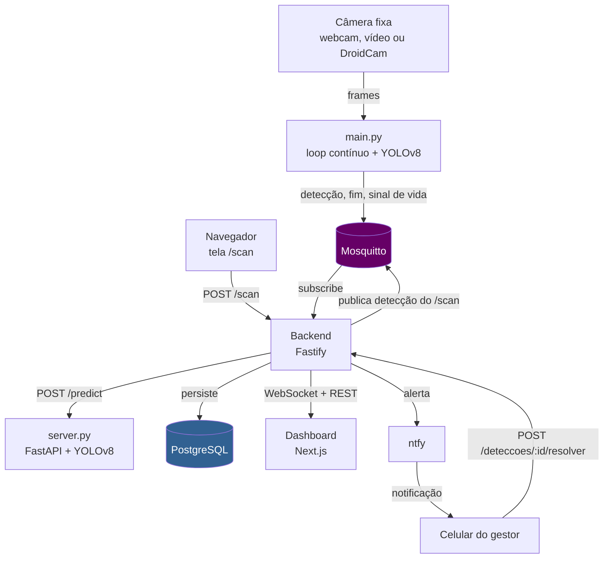
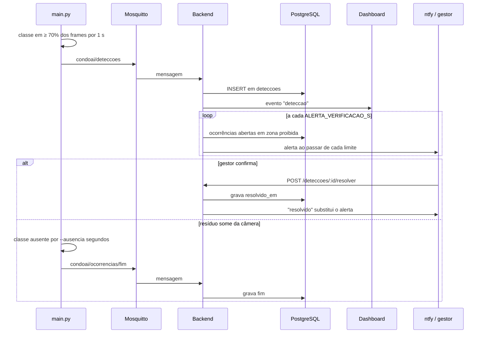
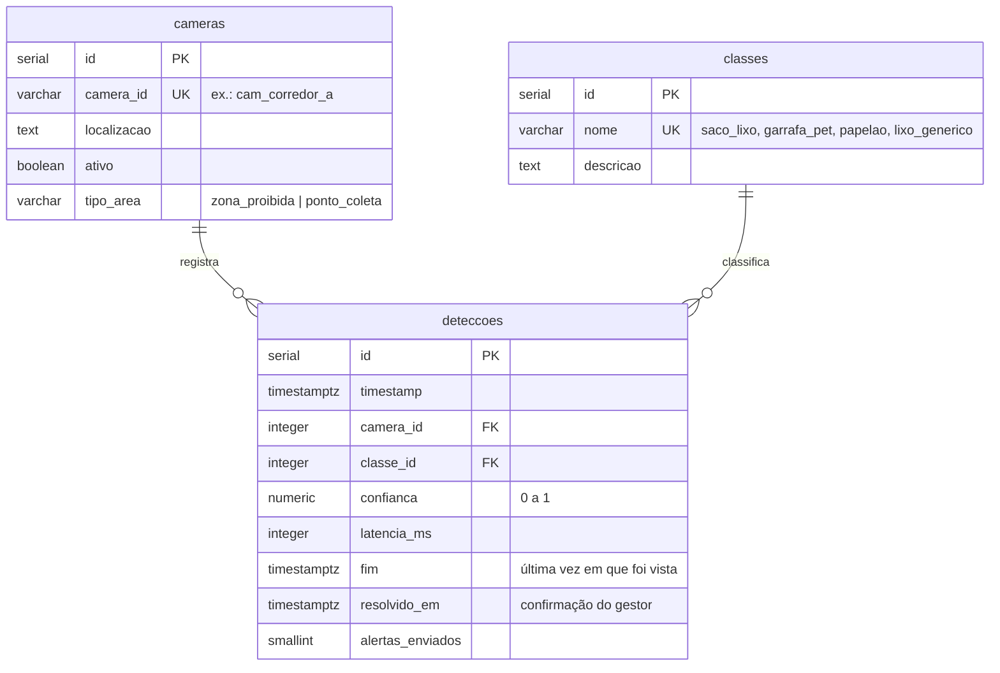

# ♻️ condoAI — Detecção de descarte de resíduos em condomínios

> Sistema que detecta resíduos sólidos em áreas comuns de condomínios com **YOLOv8**, publica cada ocorrência por **MQTT**, mostra tudo em um **dashboard em tempo real** e **avisa o gestor no celular** quando um resíduo permanece em zona proibida.

[](https://www.python.org/)
[](https://docs.ultralytics.com/)
[](https://nodejs.org/)
[](https://www.typescriptlang.org/)
[](https://fastify.dev/)
[](https://nextjs.org/)
[](https://www.postgresql.org/)
[](https://mosquitto.org/)
[](LICENSE)

> **Trabalho de Conclusão de Curso** — Ciência da Computação, UNIP (2026). Projeto em desenvolvimento, feito para rodar em `localhost` ou na rede local. Não é um sistema de produção: não tem autenticação nem deploy em nuvem.

---

## 📑 Sumário

- [Sobre](#sobre)
- [Stack](#stack)
- [Arquitetura](#arquitetura)
- [Fluxo de uma ocorrência](#fluxo-de-uma-ocorrência)
- [Modelo de dados](#modelo-de-dados)
- [Estrutura do projeto](#estrutura-do-projeto)
- [Como rodar](#como-rodar)
- [Como testar o sistema](#como-testar-o-sistema)
- [Variáveis de ambiente](#variáveis-de-ambiente)
- [Endpoints](#endpoints)
- [WebSocket](#websocket)
- [Tópicos MQTT](#tópicos-mqtt)
- [Testes automatizados](#testes-automatizados)
- [Modelo e resultados](#modelo-e-resultados)
- [Decisões técnicas](#decisões-técnicas)
- [Problemas comuns](#problemas-comuns)
- [Trabalhos futuros](#trabalhos-futuros)
- [Limitações conhecidas](#limitações-conhecidas)

---

## Sobre

Câmeras de condomínio registram o descarte irregular de lixo, mas alguém precisa olhar as imagens o tempo todo. O **condoAI** demonstra a viabilidade técnica de automatizar esse monitoramento:

- **Detecção visual** — um modelo YOLOv8 treinado em 4 classes: `saco_lixo`, `garrafa_pet`, `papelao` e `lixo_generico`.
- **Ocorrências, não frames** — o mesmo resíduo parado gera **um** registro, com início e fim, em vez de centenas de linhas.
- **Camadas desacopladas** — a inferência publica no broker MQTT sem conhecer o backend, e o backend não conhece a câmera.
- **Dashboard em tempo real** — feed de detecções, gráficos, mapa de calor e estado de cada câmera via WebSocket.
- **Alerta escalonado ao gestor** — notificação no celular quando o resíduo permanece em zona proibida (10 min, 40 min e 2 h por padrão), com botão **Resolvido**.
- **Privacidade (LGPD)** — não existe classe "pessoa" no modelo e nenhum frame é salvo em disco, exceto com `--gravar`, opção desligada por padrão e usada só para demonstração.

Tudo roda localmente, sem depender de nuvem. A referência técnica completa está em [`docs/SPEC.md`](docs/SPEC.md).

---

## Stack

| Tecnologia | Uso |
|---|---|
| **Python 3.12** | Serviço de inferência |
| **YOLOv8** (ultralytics 8.x) + **PyTorch 2.7** | Detecção de resíduos, com GPU (CUDA 11.8) ou CPU |
| **FastAPI** + **uvicorn** | `POST /predict`, inferência sob demanda por HTTP |
| **OpenCV** | Leitura de webcam, vídeo e stream; janela de preview |
| **paho-mqtt 2.x** | Publicação das ocorrências |
| **Mosquitto 2** | Broker MQTT |
| **Node.js 24** + **TypeScript** (strict, ESM) | Backend |
| **Fastify 5** + **Zod 4** | API REST e WebSocket, com validação em todas as fronteiras |
| **PostgreSQL 16** | Persistência das ocorrências |
| **ntfy** | Servidor local de notificações ao gestor |
| **Next.js 15** (App Router) + **Recharts 3** | Landing page, tela de captura e dashboard |
| **Docker Compose** | PostgreSQL, Mosquitto e ntfy em desenvolvimento |

---

## Arquitetura



| Componente | Pasta | Porta | Responsabilidade |
|---|---|---|---|
| Inferência contínua | `apps/inference/main.py` | — | Lê a câmera, controla as ocorrências e publica no MQTT |
| Inferência HTTP | `apps/inference/server.py` | `8000` | Atende o `POST /predict` usado pelo `/scan` |
| Backend | `apps/backend` | `3001` | Persiste, expõe REST e WebSocket, agenda os alertas |
| Frontend | `apps/web` | `3000` | Landing (`/`), captura (`/scan`) e dashboard (`/dashboard`) |
| PostgreSQL | Docker | `5432` | Banco de dados |
| Mosquitto | Docker | `1883`, `9001` | Broker MQTT (TCP e WebSocket) |
| ntfy | Docker | `8080` | Notificações ao gestor |

---

## Fluxo de uma ocorrência



| Situação | Registro no banco | Gera alerta? |
|---|---|---|
| Objeto aparece e é confirmado | Uma linha, com `fim` nulo | Se a câmera for `zona_proibida` e estiver online |
| Objeto continua no local | Nada novo | Sim, uma vez por limite de tempo ultrapassado |
| Objeto sai por `--ausencia` segundos (padrão: 30) | `fim` = última vez em que foi visto | Não |
| Objeto volta depois disso | Nova ocorrência | Conta do zero |
| Câmera `ponto_coleta` (como a `cam_test`) | Registra normalmente | Nunca |
| Câmera offline | Nada novo | Não, pois não se sabe se o objeto continua lá |
| Foto pelo `/scan` | Uma linha a cada captura com detecção | Nunca, pois é a `cam_test` |

---

## Modelo de dados



O estado da ocorrência é derivado das colunas:

| Estado | Condição |
|---|---|
| Aberta | `fim IS NULL AND resolvido_em IS NULL` |
| Encerrada | `fim IS NOT NULL` |
| Resolvida | `resolvido_em IS NOT NULL` |

Encerrada e resolvida podem coexistir. O schema completo está em [`apps/backend/src/db/schema.sql`](apps/backend/src/db/schema.sql).

---

## Estrutura do projeto

```
convoAI/
├── apps/
│   ├── inference/                 # Python
│   │   ├── main.py                # Loop contínuo: câmera → ocorrências → MQTT
│   │   ├── server.py              # FastAPI: POST /predict
│   │   ├── model.py               # Detector YOLOv8 (GPU, ou CPU se não houver)
│   │   ├── mqtt_client.py         # Publicação e Last Will
│   │   ├── config.py              # Classes, tópicos e variáveis de ambiente
│   │   ├── train.py               # Treino e avaliação
│   │   └── models/
│   │       ├── v1/, v3/           # Métricas e curvas de treino, sem os pesos
│   │       └── v2/                # Versão em produção, inclui o best.pt
│   ├── backend/                   # Node.js + TypeScript
│   │   ├── src/
│   │   │   ├── server.ts          # Registro de plugins e rotas
│   │   │   ├── db/                # schema.sql e migração
│   │   │   ├── plugins/           # db, mqtt, websocket, alertas
│   │   │   ├── routes/            # Uma rota REST por arquivo
│   │   │   └── schemas/           # Schemas Zod
│   │   ├── scripts/latencia.ts    # Medição da latência do pipeline
│   │   └── test/                  # smoke.test.ts e alertas.test.ts
│   └── web/                       # Next.js + TypeScript
│       ├── app/                   # /, /scan e /dashboard
│       ├── components/            # landing, camera, dashboard, ui
│       └── lib/                   # Cliente REST, WebSocket e utilitários
├── mosquitto/mosquitto.conf
├── docs/
│   ├── SPEC.md                    # Especificação técnica (fonte da verdade)
│   └── TASKS.md                   # Tarefas e resultados registrados
├── docker-compose.yml             # PostgreSQL, Mosquitto e ntfy
└── .env.example
```

---

## Como rodar

### Pré-requisitos

| Ferramenta | Versão | Observação |
|---|---|---|
| [Git](https://git-scm.com/) | atual | |
| [Docker](https://www.docker.com/) + Compose | atual | Precisa estar **aberto** antes do passo 2 |
| [Node.js](https://nodejs.org/) | **24** | O repositório tem `.nvmrc`, então `nvm use` funciona |
| [Python](https://www.python.org/) | **3.12** | Outras versões não são suportadas pelo projeto |
| GPU NVIDIA | opcional | Sem ela, o modelo roda em CPU |

**Espaço em disco:** a instalação com GPU ocupa cerca de **6 GB** só no ambiente Python. A de CPU ocupa cerca de **2 GB**.

> O passo a passo foi validado do zero no **Windows 11**, a partir de um clone limpo. Em Linux e macOS os comandos são equivalentes, mas ainda não foram testados.

Você vai precisar de **quatro terminais**, um para cada serviço. Todos partem da raiz do repositório.

### 1. Clonar

```bash
git clone https://github.com/Tiagossdj/convoAI.git
cd convoAI
```

> **No Windows, clone em um caminho curto** (ex.: `C:\dev\convoAI`). O PyTorch tem arquivos com nomes muito longos e a instalação falha em pastas profundas. Veja [Problemas comuns](#problemas-comuns).

Os pesos do modelo (`apps/inference/models/v2/best.pt`, cerca de 6 MB) **já vêm no clone**. Não é preciso baixar nem treinar nada.

### 2. Subir a infraestrutura e criar o banco

```bash
cp .env.example .env
cp apps/backend/.env.example apps/backend/.env

docker compose up -d
```

Espere uns 10 segundos para o PostgreSQL iniciar e crie as tabelas. Rode **uma única vez**, pois a tabela já existente faz o comando falhar nas próximas:

```bash
docker compose cp apps/backend/src/db/schema.sql postgres:/tmp/schema.sql
docker compose exec -T postgres sh -c "psql -U condoai -d condoai -f /tmp/schema.sql"
```

Confira. Devem aparecer `cameras`, `classes` e `deteccoes`:

```bash
docker compose exec -T postgres psql -U condoai -d condoai -c "\dt"
```

> Se trocar a senha em `.env`, troque também em `DATABASE_URL` no `apps/backend/.env`.

### 3. Serviço de inferência (terminal 1)

**Com GPU NVIDIA:**

```powershell
# Windows (PowerShell)
cd apps/inference
py -3.12 -m venv .venv
.venv\Scripts\Activate.ps1
pip install -r requirements.txt
```

```bash
# Linux
cd apps/inference
python3.12 -m venv .venv
source .venv/bin/activate
pip install -r requirements.txt
```

**Sem GPU NVIDIA:** crie e ative o `.venv` da mesma forma, mas troque o `pip install -r requirements.txt` por:

```bash
# Windows e Linux. No macOS, retire o --index-url da primeira linha
pip install torch==2.7.1 torchvision==0.22.1 --index-url https://download.pytorch.org/whl/cpu
pip install "ultralytics==8.*" "paho-mqtt==2.*" "opencv-python==4.*" "fastapi==0.*" "uvicorn==0.*" "python-multipart==0.*"
```

O código usa a GPU quando ela está disponível e a CPU quando não está, sem nenhuma configuração.

Com o ambiente ativado, suba o servidor e deixe este terminal aberto:

```bash
python server.py
```

Está pronto quando aparecer `Uvicorn running on http://127.0.0.1:8000`.

### 4. Backend (terminal 2)

```bash
cd apps/backend
npm ci
npm run dev
```

Em outro terminal, confira: `curl http://localhost:3001/health` deve responder `{"status":"ok"}`.

### 5. Frontend (terminal 3)

```bash
cd apps/web
npm ci
npm run dev
```

### 6. Pronto

| Tela | Endereço |
|---|---|
| Landing page | <http://localhost:3000> |
| Captura por foto | <http://localhost:3000/scan> |
| Dashboard | <http://localhost:3000/dashboard> |

O terminal 4 fica para a câmera contínua, explicada a seguir.

### Parar e recomeçar

```bash
docker compose stop      # para os containers e mantém os dados
docker compose start     # sobe de novo
docker compose down -v   # ⚠️ APAGA o banco; depois é preciso repetir a criação do passo 2
```

Os outros serviços param com `Ctrl+C`. Para voltar a usar, reative o `.venv` e repita `python server.py`, `npm run dev` e `npm run dev`.

---

## Como testar o sistema

Há três formas de testar, da mais simples à mais completa. Não é preciso fazer todas.

### A. Foto pela tela `/scan` (1 minuto)

1. Abra <http://localhost:3000/scan> e o [dashboard](http://localhost:3000/dashboard) em outra aba.
2. Fotografe uma caixa de papelão, garrafa PET ou saco de lixo, ou envie uma imagem.
3. O resultado aparece na tela e a detecção entra no dashboard na hora.

Sem câmera por perto, use a imagem de teste do repositório:

```bash
curl -F frame=@apps/backend/test/fixtures/papelao.jpg -F camera_id=cam_test http://localhost:3001/scan
```

### B. Câmera contínua com `main.py` (terminal 4)

É o modo principal do sistema, que simula uma câmera fixa. Primeiro, ative o ambiente:

```powershell
cd apps/inference
.venv\Scripts\Activate.ps1     # Linux/macOS: source .venv/bin/activate
```

Escolha a fonte de vídeo:

```bash
# Webcam do computador (0 é a primeira câmera; tente 1 se houver outra)
python main.py --source 0 --preview

# Um vídeo gravado por você, com objetos sendo deixados no chão
python main.py --source caminho/do/video.mp4 --preview

# Celular como câmera, usando o DroidCam
python main.py --source http://<ip-do-celular>:4747/video --preview
```

| Opção | O que faz |
|---|---|
| `--source` | **Obrigatória.** Índice da câmera, caminho de vídeo ou URL de stream |
| `--preview` | Abre uma janela com as detecções desenhadas. `q` ou `ESC` encerra |
| `--ausencia <s>` | Segundos sem ver a classe até encerrar a ocorrência (padrão: `30`) |
| `--area x1,y1,x2,y2` | Só considera detecções nessa área do quadro, com valores de 0 a 1 |
| `--definir-area` | Marca a área com o mouse, imprime o `--area` e encerra |
| `--gravar <arquivo.mp4>` | Salva o vídeo anotado. Exige `--preview` |

Para confirmar uma ocorrência, o objeto precisa ser visto em pelo menos 70% dos frames durante 1 s. Depois disso, ela aparece no dashboard e a câmera consta como **monitorando**.

> **Gravação e privacidade:** vídeos podem mostrar pessoas. Grave em ambiente controlado, com ciência dos presentes, e apague depois. Os arquivos `*.mp4` ficam fora do git.

#### Usando o celular como câmera (DroidCam)

1. Instale o **DroidCam** no celular.
2. Conecte o celular e o computador na **mesma rede Wi-Fi**.
3. Abra o app e anote o IP mostrado na tela.
4. Rode `main.py` com `--source http://<ip-do-celular>:4747/video`.

A versão gratuita aceita um cliente por vez, então mantenha fechado o cliente do DroidCam no PC.

#### Delimitando a área monitorada

Uma câmera enquadra mais do que o ponto de descarte, e objetos fixos, como tomadas, podem gerar falsos positivos. Com a câmera já fixada:

```bash
python main.py --source 0 --definir-area           # arraste um retângulo; o comando imprime o --area
python main.py --source 0 --area 0,0.45,1,1 --preview
```

### C. Alertas no celular com ntfy

Por padrão, `main.py` usa a `cam_test`, que é um ponto de coleta e **nunca gera alerta**. Para testar o ciclo completo, são quatro passos.

**1. Cadastre uma câmera em zona proibida** (uma vez só):

```bash
docker compose exec -T postgres psql -U condoai -d condoai -c "INSERT INTO cameras (camera_id, localizacao, tipo_area) VALUES ('cam_corredor_a', 'corredor_A', 'zona_proibida');"
```

**2. Configure o backend.** Descubra o IP do computador (`ipconfig` no Windows, `ip addr` no Linux) e edite `apps/backend/.env`. Os limites abaixo são acelerados para teste, com alertas em 10 s, 40 s e 2 min:

```env
BACKEND_URL_LAN=http://<ip-do-computador>:3001
ALERTA_LIMITES_S=10,40,120
ALERTA_VERIFICACAO_S=2
```

Reinicie o backend: `Ctrl+C` e `npm run dev`. O log deve mostrar `alertas ao gestor ativados`.

**3. Assine os alertas.** Com o celular na mesma rede Wi-Fi:

- **Android:** instale o app **ntfy** e assine o tópico `condoai-alertas`, informando o servidor `http://<ip-do-computador>:8080`.
- **Sem celular:** consulte os alertas pelo terminal com `curl "http://localhost:8080/condoai-alertas/json?poll=1"`.
- **iOS:** em segundo plano, a notificação passa pelo serviço da Apple e exige internet. Por isso, a demonstração do projeto usa Android.

**4. Rode a câmera** com a identificação cadastrada:

```powershell
# Windows (PowerShell)
$env:CAMERA_ID="cam_corredor_a"; $env:LOCALIZACAO="corredor_A"
python main.py --source 0 --preview
```

```bash
# Linux/macOS/Git Bash
CAMERA_ID=cam_corredor_a LOCALIZACAO=corredor_A python main.py --source 0 --preview
```

Deixe um objeto em frente à câmera. Depois de 10 s chega o alerta, e o botão **Resolvido** grava a confirmação e encerra os avisos daquela ocorrência.

Sem `NTFY_URL` ou `BACKEND_URL_LAN`, os alertas ficam desativados e o resto do sistema funciona normalmente.

### Acessando de outro aparelho (celular, colega na mesma rede)

Quem está na mesma rede pode usar o sistema sem instalar nada, pelos endereços abaixo:

- Dashboard: `http://<ip-do-computador>:3000/dashboard`
- Captura: `http://<ip-do-computador>:3000/scan`

Pela rede local, a tela `/scan` abre a câmera nativa do aparelho em vez da câmera embutida na página, porque o navegador só libera esse acesso em HTTPS ou `localhost`. O restante do fluxo é igual.

No Windows, marque a rede como **Privada** e libere as portas no PowerShell **como administrador**:

```powershell
New-NetFirewallRule -DisplayName "condoAI LAN" -Direction Inbound -Protocol TCP -LocalPort 3000,3001,8080 -Action Allow -Profile Private
```

---

## Variáveis de ambiente

### `.env` (raiz, usado pelo Docker Compose)

| Variável | Exemplo | Descrição |
|---|---|---|
| `POSTGRES_USER` | `condoai` | Usuário do banco |
| `POSTGRES_PASSWORD` | `changeme` | Senha do banco |
| `POSTGRES_DB` | `condoai` | Nome do banco |

### `apps/backend/.env`

| Variável | Obrigatória | Padrão | Descrição |
|---|---|---|---|
| `DATABASE_URL` | ✓ | — | Conexão PostgreSQL |
| `MQTT_HOST` | | `localhost` | Host do broker |
| `MQTT_PORT` | | `1883` | Porta do broker |
| `PORT` | | `3001` | Porta do backend |
| `INFERENCE_URL` | | `http://localhost:8000` | Serviço de inferência |
| `NTFY_URL` | para alertas | — | Servidor ntfy |
| `NTFY_TOPICO` | | `condoai-alertas` | Tópico dos alertas |
| `BACKEND_URL_LAN` | para alertas | — | Endereço do backend visto pelo celular, usado pelo botão **Resolvido** |
| `ALERTA_LIMITES_S` | | `600,2400,7200` | Limites de permanência em segundos, em ordem crescente |
| `ALERTA_VERIFICACAO_S` | | `60` | Intervalo de verificação do agendador |

### `apps/inference` (opcionais, definidas no terminal)

| Variável | Padrão | Descrição |
|---|---|---|
| `CAMERA_ID` | `cam_test` | Precisa existir na tabela `cameras`; se não existir, a detecção é descartada |
| `LOCALIZACAO` | `Ambiente de teste — desenvolvimento` | Nome do local enviado no payload |
| `MODEL_VERSION` | `v2` | Versão usada para montar o caminho dos pesos |
| `MODEL_PATH` | `models/<MODEL_VERSION>/best.pt` | Caminho explícito para os pesos |
| `MQTT_HOST` | `localhost` | Host do broker |
| `MQTT_PORT` | `1883` | Porta do broker |

### `apps/web/.env` (opcionais)

| Variável | Padrão | Descrição |
|---|---|---|
| `NEXT_PUBLIC_API_URL` | mesmo host da página, porta `3001` | URL do backend |
| `NEXT_PUBLIC_WS_URL` | mesmo host da página, porta `3001`, `/ws` | WebSocket do backend |

---

## Endpoints

**Base URL:** `http://localhost:3001`

| Método | Caminho | Descrição |
|---|---|---|
| `GET` | [`/health`](#get-health) | Health check |
| `GET` | [`/classes`](#get-classes) | Classes detectáveis |
| `GET` | [`/cameras`](#get-cameras) | Câmeras ativas |
| `POST` | [`/scan`](#post-scan) | Envia uma foto para inferência |
| `GET` | [`/deteccoes`](#get-deteccoes) | Lista paginada de detecções |
| `GET` | [`/deteccoes/:id`](#get-deteccoesid) | Uma detecção |
| `POST` | [`/deteccoes/:id/resolver`](#post-deteccoesidresolver) | Confirma a resolução pelo gestor |
| `GET` | [`/estatisticas`](#get-estatisticas) | Total e contagem por classe |
| `GET` | [`/painel`](#get-painel) | Agregados do dashboard |

Não há autenticação. As respostas abaixo são de execuções reais.

**Erros.** As rotas devolvem um destes dois formatos:

```json
{ "error": "detecção não encontrada" }
```

```json
{
  "statusCode": 400,
  "code": "FST_ERR_VALIDATION",
  "error": "Bad Request",
  "message": "querystring/limite Too big: expected number to be <=200"
}
```

O primeiro vem das regras das rotas. O segundo vem da validação automática de parâmetros.

### `GET /health`

```json
{ "status": "ok" }
```

| Status | Quando |
|---|---|
| `200` | Backend no ar |

### `GET /classes`

```json
[
  { "id": 1, "nome": "saco_lixo" },
  { "id": 2, "nome": "garrafa_pet" },
  { "id": 3, "nome": "papelao" },
  { "id": 4, "nome": "lixo_generico" }
]
```

| Status | Quando |
|---|---|
| `200` | Sempre, ordenado por `id` |

### `GET /cameras`

```json
[
  { "id": 1, "camera_id": "cam_test", "localizacao": "Ambiente de teste — desenvolvimento" }
]
```

| Status | Quando |
|---|---|
| `200` | Lista as câmeras com `ativo = true` |

### `POST /scan`

Envia uma imagem em `multipart/form-data`. O backend chama o serviço de inferência e fica com a detecção de maior confiança. Havendo detecção, ela é publicada no MQTT, gravada e transmitida ao dashboard. A imagem não é salva.

| Campo | Tipo | Descrição |
|---|---|---|
| `frame` | arquivo | Imagem JPEG ou PNG, até 10 MB |
| `camera_id` | texto | Câmera cadastrada (o frontend usa `cam_test`) |

```bash
curl -F frame=@apps/backend/test/fixtures/papelao.jpg -F camera_id=cam_test http://localhost:3001/scan
```

```json
{
  "classe": "papelao",
  "confianca": 0.984,
  "bbox": [0, 0.3, 636.3, 640],
  "latencia_ms": 261,
  "timestamp": "2026-11-04T18:00:45.360Z"
}
```

`bbox` é `[x1, y1, x2, y2]` em pixels da imagem. Sem detecção, os três primeiros campos são nulos e nada é gravado:

```json
{
  "classe": null,
  "confianca": null,
  "bbox": null,
  "latencia_ms": 781,
  "timestamp": "2026-11-04T18:08:13.206Z"
}
```

| Status | Quando | Resposta |
|---|---|---|
| `200` | Inferência concluída, com ou sem detecção | Acima |
| `400` | Requisição não é multipart | `{ "error": "esperado multipart/form-data" }` |
| `400` | Falta o arquivo | `{ "error": "campo frame ausente" }` |
| `400` | Falta a câmera | `{ "error": "campo camera_id ausente" }` |
| `400` | Câmera não cadastrada ou inativa | `{ "error": "câmera não cadastrada: nao_existe" }` |
| `400` | Arquivo não é uma imagem legível | `{ "error": "imagem inválida" }` |
| `413` | Arquivo maior que 10 MB | `{ "statusCode": 413, "code": "FST_REQ_FILE_TOO_LARGE", "error": "Payload Too Large", "message": "request file too large" }` |
| `502` | Serviço de inferência fora do ar | `{ "error": "serviço de inferência indisponível" }` |

### `GET /deteccoes`

Lista as detecções da mais recente para a mais antiga.

| Query | Padrão | Descrição |
|---|---|---|
| `limite` | `50` | Itens por página, de 1 a 200 |
| `cursor` | — | `next_cursor` da página anterior |
| `camera_id` | — | Filtra pela câmera, ex.: `cam_test` |
| `classe` | — | Filtra pela classe, ex.: `papelao` |
| `de` | — | Só detecções a partir desse instante, em ISO 8601 |

```bash
curl "http://localhost:3001/deteccoes?classe=papelao&camera_id=cam_test&limite=1"
```

```json
{
  "data": [
    {
      "id": 1,
      "timestamp": "2026-11-04T18:00:45.360Z",
      "camera": {
        "id": 1,
        "camera_id": "cam_test",
        "localizacao": "Ambiente de teste — desenvolvimento"
      },
      "classe": { "id": 3, "nome": "papelao" },
      "confianca": 0.984,
      "latencia_ms": 261,
      "fim": null,
      "resolvido_em": null
    }
  ],
  "next_cursor": null
}
```

`next_cursor` é `null` na última página.

| Status | Quando |
|---|---|
| `200` | Lista, possivelmente vazia |
| `400` | `limite` fora da faixa, ou `cursor` e `de` fora do formato ISO 8601 |

### `GET /deteccoes/:id`

Devolve o mesmo objeto de cada item de `data`, acima.

| Status | Quando | Resposta |
|---|---|---|
| `200` | Encontrada | Objeto da detecção |
| `404` | Não existe | `{ "error": "detecção não encontrada" }` |
| `400` | `id` não é inteiro | `{ "statusCode": 400, "code": "FST_ERR_VALIDATION", "error": "Bad Request", "message": "params/id Invalid input: expected number, received NaN" }` |

### `POST /deteccoes/:id/resolver`

Confirmação do gestor, chamada pelo botão **Resolvido** do alerta. É idempotente: repetir a chamada mantém o primeiro `resolvido_em` e não envia outra notificação.

```bash
curl -X POST http://localhost:3001/deteccoes/1/resolver
```

```json
{
  "id": 1,
  "timestamp": "2026-11-04T18:00:45.360Z",
  "camera": {
    "id": 1,
    "camera_id": "cam_test",
    "localizacao": "Ambiente de teste — desenvolvimento"
  },
  "classe": { "id": 3, "nome": "papelao" },
  "confianca": 0.984,
  "latencia_ms": 261,
  "fim": null,
  "resolvido_em": "2026-11-04T18:00:51.069Z"
}
```

| Status | Quando | Resposta |
|---|---|---|
| `200` | Primeira chamada ou repetição | Objeto da detecção |
| `404` | Não existe | `{ "error": "detecção não encontrada" }` |
| `400` | `id` não é inteiro | Erro de validação |
| `400` | `Content-Type: application/json` com corpo vazio | `{ "statusCode": 400, "code": "FST_ERR_CTP_EMPTY_JSON_BODY", "error": "Bad Request", "message": "Body cannot be empty when content-type is set to 'application/json'" }` |

> Envie a requisição sem `Content-Type`, ou com `Content-Type: application/json` e corpo `{}`, como faz o botão do ntfy.

### `GET /estatisticas`

As 4 classes aparecem sempre, mesmo com total zero. `ultimo_id` é o maior `id` contado, ou `null` se não houver detecções.

```json
{
  "total": 1,
  "ultimo_id": 1,
  "por_classe": [
    { "classe": "saco_lixo", "total": 0 },
    { "classe": "garrafa_pet", "total": 0 },
    { "classe": "papelao", "total": 1 },
    { "classe": "lixo_generico", "total": 0 }
  ]
}
```

| Status | Quando |
|---|---|
| `200` | Sempre |

### `GET /painel`

Agregados do dashboard em uma única chamada. Horas e dias seguem o fuso `America/Sao_Paulo`.

| Query | Padrão | Valores |
|---|---|---|
| `periodo` | `24h` | `24h`, `7d` ou `30d` |

Resposta com as listas encurtadas:

```json
{
  "periodo": "24h",
  "de": "2026-11-03T19:00:00.000Z",
  "ate": "2026-11-04T18:00:53.530Z",
  "intervalo": "hora",
  "indicadores": {
    "total_periodo": 1,
    "hoje": 1,
    "ontem": 0,
    "total_geral": 1,
    "confianca_media": 0.984,
    "latencia_ms": { "p50": 261, "p95": 261, "max": 261 }
  },
  "serie": [
    { "inicio": "2026-11-03T19:00:00.000Z", "saco_lixo": 0, "garrafa_pet": 0, "papelao": 0, "lixo_generico": 0 }
  ],
  "heatmap_30d": [{ "dia_semana": 3, "hora": 15, "total": 1 }],
  "por_classe": [{ "classe": "saco_lixo", "total": 0, "confianca_media": null }],
  "por_camera": [
    {
      "camera_id": "cam_test",
      "localizacao": "Ambiente de teste — desenvolvimento",
      "total": 1,
      "ultima": "2026-11-04T18:00:45.360Z"
    }
  ],
  "latencia_hist": [{ "de_ms": 0, "ate_ms": 10, "total": 0 }],
  "confianca_hist": [
    { "faixa": "0.4-0.5", "saco_lixo": 0, "garrafa_pet": 0, "papelao": 0, "lixo_generico": 0 }
  ]
}
```

| Campo | Descrição |
|---|---|
| `intervalo` | `hora` em `24h`; `dia` em `7d` e `30d` |
| `indicadores` | Totais, confiança média e latência. `latencia_ms` é `null` sem detecções no período |
| `serie` | Contagem por classe em cada intervalo, inclusive os zerados |
| `heatmap_30d` | Sempre os últimos 30 dias, só células com total > 0. `dia_semana` 0 é domingo |
| `por_classe` | As 4 classes, inclusive zeradas |
| `por_camera` | Câmeras ativas, inclusive sem detecções (`ultima: null`) |
| `latencia_hist` | Faixas de 0 a 3000 ms. A última tem `ate_ms: null` e significa "3 s ou mais" |
| `confianca_hist` | Faixas de 0,1 entre 0,4 e 1,0, por classe |

| Status | Quando | Resposta |
|---|---|---|
| `200` | Período válido | Acima |
| `400` | Período inválido | `{ "statusCode": 400, "code": "FST_ERR_VALIDATION", "error": "Bad Request", "message": "querystring/periodo Invalid option: expected one of \"24h\"\|\"7d\"\|\"30d\"" }` |

### Serviço de inferência: `POST /predict`

Serviço interno em `http://127.0.0.1:8000`, chamado pelo backend. A documentação interativa fica em <http://localhost:8000/docs>.

```bash
curl -F frame=@apps/backend/test/fixtures/papelao.jpg http://localhost:8000/predict
```

```json
{
  "deteccoes": [
    { "classe": "papelao", "confianca": 0.984, "bbox": [0.0, 0.3, 636.3, 640.0] }
  ],
  "inferencia_ms": 197
}
```

| Status | Quando | Resposta |
|---|---|---|
| `200` | Inferência concluída | Acima; `deteccoes` vazia se nada passar do limiar de 0,4 |
| `400` | Imagem ilegível | `{ "error": "imagem inválida" }` |

---

## WebSocket

**Endpoint:** `ws://localhost:3001/ws`

Ao conectar, o cliente recebe um evento `status` para cada câmera conhecida. Depois, os eventos chegam conforme acontecem.

**`deteccao`** — nova ocorrência registrada:

```json
{
  "event": "deteccao",
  "data": {
    "id": 42,
    "timestamp": "2026-10-05T14:32:00.000Z",
    "camera_id": "cam_hall",
    "classe": "saco_lixo",
    "confianca": 0.847,
    "localizacao": "Hall de entrada",
    "latencia_ms": 214
  }
}
```

**`status`** — sinal de vida da câmera, a cada 10 s:

```json
{
  "event": "status",
  "data": {
    "camera_id": "cam_hall",
    "estado": "online",
    "modelo": "v2",
    "fps": 31.6,
    "ultimo_sinal": "2026-10-08T14:32:00.000Z",
    "idade_s": 3
  }
}
```

O dashboard mostra a câmera como **offline** quando `estado` é `offline` ou depois de 30 s sem sinal.

---

## Tópicos MQTT

Broker em `localhost:1883`, sem autenticação.

| Tópico | Publicado por | Conteúdo |
|---|---|---|
| `condoai/deteccoes` | `main.py`, `POST /scan` | Uma mensagem por ocorrência |
| `condoai/ocorrencias/fim` | `main.py` | Fim de uma ocorrência |
| `condoai/status/<camera_id>` | `main.py`, broker (Last Will) | Sinal de vida, com retain |

```json
{
  "timestamp": "2026-10-05T14:32:00.000Z",
  "camera_id": "cam_hall",
  "classe": "saco_lixo",
  "confianca": 0.847,
  "localizacao": "Hall de entrada",
  "latencia_ms": 214
}
```

Os payloads de fim e de sinal de vida estão na [seção 4 da spec](docs/SPEC.md#4-protocolo-mqtt).

---

## Testes automatizados

Os testes são de integração: exercitam o sistema real, então os serviços precisam estar no ar. Eles removem o que criam no banco.

### Pipeline completo — `test/smoke.test.ts` (5)

**Pré-requisitos:** Docker, `server.py` e backend no ar.

```bash
cd apps/backend
npm run test:smoke
```

- ✅ `GET /health` responde ok
- ✅ Foto de papelão percorre `/scan` → MQTT → banco → WebSocket → `GET /deteccoes`
- ✅ Sinal de vida chega como evento `status` e como snapshot ao conectar
- ✅ `GET /painel` confere com o banco e com o fuso local
- ✅ Fim da ocorrência grava `fim`, e `POST /deteccoes/:id/resolver` grava `resolvido_em`

### Alertas ao gestor — `test/alertas.test.ts` (3)

**Pré-requisitos:** Docker e backend no ar com limites acelerados. Edite `apps/backend/.env` e reinicie o backend:

```env
ALERTA_LIMITES_S=2,4,6
ALERTA_VERIFICACAO_S=1
BACKEND_URL_LAN=http://localhost:3001
```

```bash
cd apps/backend
npm run test:alertas
```

- ✅ Um alerta por limite, com prioridade crescente e sem imagem
- ✅ O botão **Resolvido** grava `resolvido_em` e interrompe os alertas
- ✅ Não alertam: ocorrência encerrada, câmera offline, `ponto_coleta`, ocorrência órfã com sucessora encerrada e ocorrência anterior à sessão

### Latência do pipeline

```bash
cd apps/backend
npm run latencia -- test/fixtures/papelao.jpg 50
```

Esse comando grava as detecções no banco, pois mede o caminho real.

---

## Modelo e resultados

Todas as versões usam YOLOv8n. As métricas são do split de **teste**:

| Versão | Dataset | Épocas | mAP@50 |
|---|---|---|---|
| v1 | `condoai` (TACO + TrashNet) | 50 | 47,3% |
| **v2 (em uso)** | `condoai_v2` (+ WasteInsight) | 50 | **67,7%** |
| v3 | `condoai_v2` | 100 | 66,6% |

Curvas, matriz de confusão e detalhes estão em `apps/inference/models/<versão>/`. O repositório inclui só os pesos da v2.

| Hipótese | Meta | Resultado |
|---|---|---|
| **H1** — qualidade do modelo | mAP@50 ≥ 65,9% | **67,7%** ✅ |
| **H2** — latência do pipeline | < 3 s | Mediana de **26,8 ms**, máximo de 42,2 ms ✅ |

A H2 foi medida com GTX 1650 (CUDA 11.8) em `localhost`, do `/scan` até o evento WebSocket. Não inclui a captura no navegador nem a rede até o celular. Sem GPU, a latência será maior. A metodologia está na [seção 1.5 da spec](docs/SPEC.md#15-latência-medida-validação-da-h2).

**Treinar de novo:** o dataset não está no repositório. Exporte-o do Roboflow para `apps/inference/datasets/<pasta>/` e rode `python train.py --versao <versão> --dataset <pasta> --epocas <n>`. O treino exige GPU NVIDIA.

---

## Decisões técnicas

- **MQTT entre as camadas** — desacoplamento real: a inferência não conhece o backend e cada camada pode ser reiniciada sem derrubar as outras.
- **Python só na inferência** — o ultralytics é nativo em Python; o restante fica em TypeScript strict e ESM.
- **Ocorrência em vez de frame** — a 30 fps, gravar por frame criaria centenas de linhas por descarte. A confirmação em 70% dos frames filtra falsos positivos intermitentes.
- **Caminho único no `/scan`** — a foto também passa pelo MQTT, então toda detecção é persistida e transmitida pelo mesmo código.
- **Modelo mantido em memória no `server.py`** — iniciar o `main.py` a cada foto recarregaria o modelo a cada requisição, com 2 a 5 s de overhead.
- **Last Will com retain** — se o `main.py` cair, o próprio broker publica `offline`. Há um tópico por câmera porque o broker retém só uma mensagem por tópico.
- **Alerta por permanência** — avisar em limites crescentes, e não a cada detecção, evita que o gestor pare de ler. Todos os alertas de uma ocorrência substituem o anterior no celular.
- **ntfy local** — dispensa conta e serviço externo, então o alerta chega ao Android mesmo sem internet.
- **Zod em todas as fronteiras** — rotas, payloads MQTT e respostas da API no frontend são validados em tempo de execução.
- **Pesos da v2 no repositório** — são só 6 MB e permitem rodar logo após o clone, enquanto dataset e demais versões ficam de fora.

---

## Problemas comuns

| Sintoma | Causa | Solução |
|---|---|---|
| `pip` cita *Windows Long Path* ou `DLL load failed` ao importar o torch | Pasta do projeto em um caminho longo demais | Clone em um caminho curto (`C:\dev\convoAI`), apague o `.venv` e reinstale, ou [ative os caminhos longos](https://pip.pypa.io/warnings/enable-long-paths) |
| `Bind for 0.0.0.0:5432 failed` ao subir o Docker | Outro serviço usa a porta | Pare o PostgreSQL local ou outros containers. Vale também para `1883`, `9001` e `8080` |
| `EADDRINUSE` no backend ou no frontend | Instância anterior ainda no ar | Encerre o processo que usa `3001` ou `3000` |
| Backend não sobe e cita `ECONNREFUSED` ou senha do banco | Docker parado, ou senhas diferentes nos dois `.env` | Rode `docker compose ps` e compare os arquivos |
| `relation "cameras" does not exist` | Tabelas não criadas | Rode a criação do banco, no passo 2 |
| `relation "cameras" already exists` | Criação já feita antes | Nada a fazer. Para zerar: `docker compose down -v` e repita o passo 2 |
| `/scan` responde `502` | `server.py` fora do ar | Suba no terminal 1 e espere o `Uvicorn running` |
| `Activate.ps1` bloqueado por política de execução | Restrição do PowerShell | `Set-ExecutionPolicy -Scope Process RemoteSigned` |
| Câmera aparece online, mas nada entra no banco | `CAMERA_ID` não cadastrado | Cadastre na tabela `cameras`. O log do backend mostra `câmera não cadastrada` |
| Nenhum alerta chega | Câmera é `ponto_coleta`, limites longos ou `BACKEND_URL_LAN` sem editar | Refaça a [parte C](#c-alertas-no-celular-com-ntfy). O objeto também precisa continuar visível até o limite |
| Celular não abre o sistema ou o botão **Resolvido** falha | Firewall ou redes diferentes | Libere as portas e confira a rede. Uma regra de bloqueio para `node.exe` ou Docker prevalece sobre a de liberação; remova-a |
| `429` ao consultar o ntfy | Limite de requisições do ntfy | Consulte com menos frequência e espere alguns minutos |
| DroidCam não abre em `--source` | Redes diferentes ou cliente do PC aberto | Confira a URL no navegador e feche o cliente do DroidCam |
| Inferência lenta | Rodando em CPU | Esperado sem GPU NVIDIA. O `/scan` responde normalmente, com mais demora |

---

## Trabalhos futuros

- [ ] Deploy em nuvem e acesso fora da rede local
- [ ] Autenticação de usuários, inclusive na rota de resolução e no tópico do ntfy
- [ ] Múltiplas câmeras simultâneas em escala
- [ ] Inferência em hardware embarcado (Jetson Nano, Raspberry Pi + Coral)
- [ ] Tracking por objeto, com ID para cada item
- [ ] Recorte da área monitorada antes da inferência, aumentando o tamanho relativo dos resíduos
- [ ] Área monitorada salva no cadastro da câmera, em vez do argumento `--area`

---

## Limitações conhecidas

### Controle por classe
Dois sacos de lixo ao mesmo tempo formam **uma** ocorrência de `saco_lixo`. "O resíduo continua no local" significa "a classe continua presente na área".

### Sem autenticação
Quem estiver na rede local pode ver o dashboard, assinar o tópico de alertas ou chamar a rota de resolução. O projeto foi feito para demonstração em rede local. **Não exponha estas portas na internet.**

### Alerta durante a janela de ausência
O fim só é publicado depois de `--ausencia` segundos sem ver a classe. Um limite que vença nessa janela gera alerta para um resíduo que já saiu. Com os limites padrão o caso é raro; com limites acelerados, ele aparece.

### Queda do `main.py`
Se o processo cair, as ocorrências em andamento ficam abertas, sem `fim`. A câmera aparece offline e essas ocorrências não geram alertas, nem depois de o monitoramento recomeçar.

### `/scan` com o broker fora do ar
A resposta é `200` com a detecção, mas ela não é gravada nem aparece no dashboard, porque o registro depende do MQTT. O backend registra um aviso no log.

### Falsos positivos
O modelo tem mAP@50 de 67,7% e 776 anotações de `saco_lixo`, bem menos que as demais classes. Objetos fixos podem ser detectados como resíduo; use `--area` para reduzir esse efeito.

### Notificações no iOS
Em segundo plano, o iOS só entrega notificações pelo serviço da Apple, que exige internet. O funcionamento sem internet vale para Android.

---

## 📄 Licença

[MIT](LICENSE)

---

⭐ Se este projeto te ajudou, deixe uma estrela!
